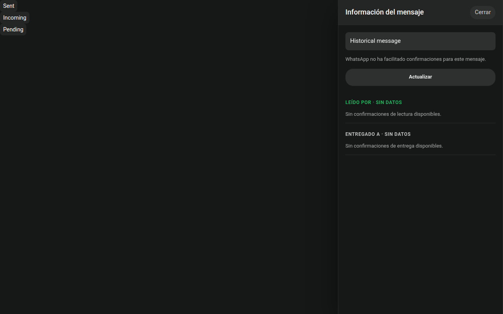
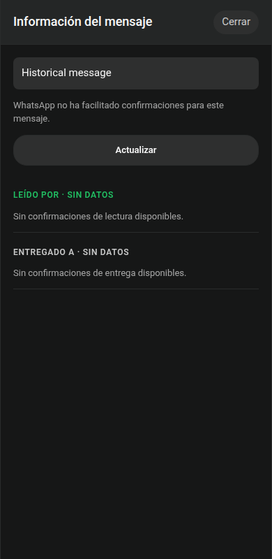
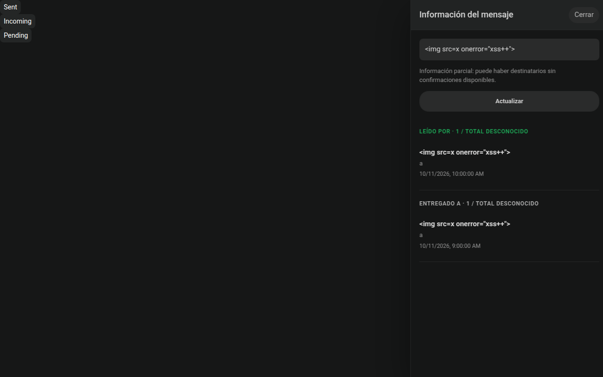
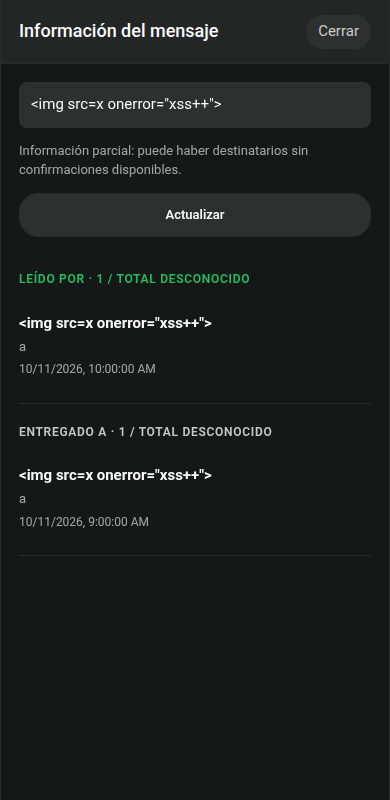

# WhatsApp group receipts and retained deletion dates

## Scope

Outgoing group messages show sent, delivered and read checks. Individual receipts
are stored separately from message metadata, scoped by account/chat/message, to
avoid triggering conversation memory indexing on each receipt. Delivery/read
aggregation requires every recipient in the immutable send-time snapshot, unless
WhatsApp provides an authoritative aggregate status. Historical group membership
is not inferred from today's group members.

The context menu for persisted outgoing messages opens message information with
recipient names and the real delivery, read and played timestamps captured from
WhatsApp. Missing receipt times or historical recipient totals remain unknown.
The information endpoint is authenticated and read-only, independent of the send
permission gate. Account, chat and provider message identities are validated at
both boundaries; late responses cannot populate another chat or account's panel.

Remote deletion retains captured content and displays when SocialMedia recorded
the deletion. This is not a claim about an unavailable remote deletion timestamp.
Legacy timestamp-without-time-zone values are interpreted as UTC; display uses
the browser's local time zone. First recorded deletion time remains immutable.

Published migrations 033-037 remain unchanged. Additive migration 038 introduces
receipt state and backfills only proven sent states for captured outgoing payloads;
it never fabricates delivered/read evidence. Telegram remains excluded from
Hindsight. The existing backend and Hindsight runtime configuration are preserved.

## Validation

- Complete WhatsApp web suite: 536 tests passed.
- Message-information UI: 24 focused tests passed; Playwright validated the menu,
  panel, scope changes, escaped names and desktop/mobile layout at 1280 and 390 px.
- Real disposable PostgreSQL validates both legacy and timezone-aware deletion
  timestamps under Europe/Madrid against the same UTC instant.
- 71 connector tests passed and cover out-of-order and concurrent PN/LID receipts, immutable
  recipient snapshots, all-recipient aggregation and terminal message states.
- No synthetic messages or votes are sent to production for QA.

Screenshots are generated by `apps/whatsapp/test/message-info-ui.playwright.mjs`.
Production image digests and verification are recorded in PR74 after publication.

## Historical receipt recovery correction

Opening message information now requests a bounded history window from the paired
phone when no individual confirmations have been captured. The anchor is a real
stored successor in the same account/chat; it never fabricates an ID or timestamp.
Only matching message receipt evidence is imported, including when normal login
history ingestion is disabled. This does not initiate a full backfill or send a
chat message. Requests are coalesced, bounded and cooled down; response/timeout
states do not discard already captured evidence.

An empty historical receipt list is displayed as **Sin datos**, not as zero actual
readers or recipients. During recovery the panel polls at most three times, and
closing it or changing chat/account cancels updates. WhatsApp may not supply old
confirmations; a successful request is not proof that those data were recovered.

Focused UI tests and Playwright cover pending-to-complete responses with and
without receipts, cancellation, unknown empty counts and bounded polling. The app
validates optional recovery state/delay and does not forward provider debug data.

The corrected web suite passes 540 tests. Real disposable PostgreSQL validates
the successor anchor, account/chat isolation and receipt-only history ingestion
before the login history gate, with no content, metadata or contact writes.
33 focused connector tests and TypeScript noEmit pass, including early/foreign
session correlation, late replies, four permanently unresponsive requests and
fresh receipt snapshots when recovery completes during an information read.

